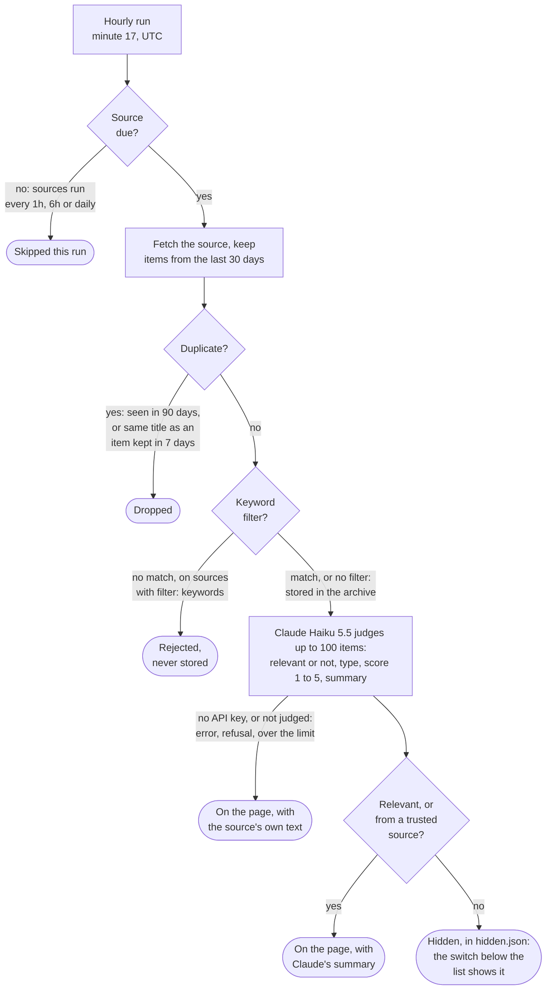

# AI and formalization news

A static news page kept by the Beneficial AI Foundation. Every hour a GitHub Actions job collects new papers, Lean and Mathlib updates, blog posts and social posts about AI and formal verification, removes duplicates, optionally asks Claude to check relevance and write a one-sentence summary, and redeploys the page on GitHub Pages. There is no server and no database.

- Page: <https://beneficial-ai-foundation.github.io/ai-formalization-news/>
- Atom feed: `feed.xml` on the same site

## How it works

What happens to each item, from its source to the page:



Items on the page go into `news.json` (newest 300), `search.json` and `feed.xml` (newest 50). The job commits to the `data` branch only if something changed, then deploys the page. Items Claude could not judge are retried on later runs for up to 3 days; an item Claude refuses to judge is not sent again. Hacker News stories also need 5 points.

Where each rule is set:

| To change | Edit |
| --- | --- |
| Which sources run, and how often | `enabled` and `every` for the source in `config/sources.yaml` |
| How far back a source looks | `max_age_days` for the source (default 30) |
| The keyword list, and which sources use it | `keywords`, and `filter: keywords` for the source |
| Which sources are never hidden | `trusted: true` for the source |
| The model, and how many items it judges per run | `claude.model` (or the repository variable `CLAUDE_MODEL`) and `claude.max_items_per_run` |
| What counts as relevant | the instructions to Claude (`SYSTEM_PROMPT`) in `news/claude.py` |

Step by step:

1. `.github/workflows/update.yml` runs at minute 17 of every hour (UTC), or by hand from the Actions tab.
2. `python -m news.run` fetches every enabled source in `config/sources.yaml` that is due, sending `If-None-Match` and `If-Modified-Since`, so unchanged feeds answer 304.
3. Links are normalised and each item gets an id. Items already seen, or with the same title as an item kept in the last 7 days, are dropped.
4. Sources marked `filter: keywords` keep only items that match a keyword.
5. If an `ANTHROPIC_API_KEY` or `OPENROUTER_API_KEY` secret is set (see Claude summaries), one Claude request tags each new item as relevant or not, picks its type, scores it from 1 to 5 and writes a summary of at most 160 characters. Items judged off topic are hidden, not deleted: the page, search and the feed leave them out, and a switch below the list shows them. Items from sources marked `trusted` are never hidden. Without the key, the page shows each source's own text.
6. The job writes `news.json` (newest 300 items), `hidden.json` (newest 300 hidden items), `archive/YYYY-MM.json` (every kept item, never trimmed), `search.json` (compact rows for search), `meta.json` (run time, counts, errors) and `feed.xml`, checks them against `schema/news.schema.json`, commits them to the `data` branch only if items changed, and deploys the page (trying twice more, 2 and 5 minutes later, if GitHub's deploy fails).

A failing source never stops the run; its error shows in `meta.json` and on the page.

## Where the data lives

The code is on `main`; the generated data is on a separate `data` branch, which the workflow starts on its first run and commits to every hour that brings something new. The page is built from `main`'s `site/` and the `data` branch's files. So `main` keeps its pull-request rule and holds only code, and the hourly commits stay out of its history.

- To show, hide or remove an item by hand, see Fix an item on the page.
- To preview the live data locally: `git fetch origin data && git worktree add ../news-data origin/data`, then `.venv/bin/python -m news.serve --data-dir ../news-data`.
- Locally, `python -m news.run` writes to `data/`, which is git-ignored on `main`.

## Fix an item on the page

Every item is stored in `archive/YYYY-MM.json` on the `data` branch, where `YYYY-MM` is the month in the item's `published` date. Each run rebuilds `news.json`, `hidden.json`, `search.json` and `feed.xml` from the archive, so edit only the archive. The job judges only items that have no verdict yet and never rewrites an item already in the archive, so a hand edit stays.

1. On GitHub, switch to the `data` branch, open the archive file and choose "Edit this file" (the pencil).
2. Press Ctrl+F and search for the item's link, as shown on the page. Each item is one `{ ... }` block that starts with its `"id"`.
3. Make one of the changes below, then commit directly to `data` with a message that says why, for example "Show arxiv:2611.27631: type systems for safe learning".
4. The page changes after the next run (minute 17 of every hour), or run "Update news" by hand from the Actions tab.

| To | Change in the item's block |
| --- | --- |
| Show an item Claude hid | Delete the line `"hidden": true,`. Also change `"relevant": false` to `true`, to record the correction, and rewrite `summary` if it reads as a verdict, for example "..., not involving formal proofs". |
| Hide an item | Add the line `"hidden": true,`. The item moves behind the switch below the list. This works for items from `trusted` sources too. |
| Take an item off the site entirely | Delete its whole `{ ... }` block, and the comma that separates it from the next block. `seen.json` keeps the item from coming back. |
| Correct a summary | Edit `summary`, at most 160 characters. |
| Have Claude judge an item again | Set `relevant`, `score` and `summary` to `null`, and delete `"hidden": true` if it is there. This works only within 3 days of the item's `fetched` time, and Claude may hide it again. |

Check the "Update news" run after your edit. A file that is not valid JSON (often a missing or extra comma) or that breaks a rule in `schema/news.schema.json` (such as a summary over 160 characters) stops the run: the page stops updating, while still showing its last good version, until the file is fixed. If the hourly job is running when you commit, it replays its own commit on top of yours, so your edit is not lost; if both changed the same lines, that run fails and the next run starts from your edit.

## Repository layout

```
.github/workflows/update.yml   hourly schedule: run, commit to the data branch if changed, deploy
.github/scripts/data_branch.sh check out and commit to the data branch
config/sources.yaml            sources, keywords and Claude settings
config/search_synonyms.yaml    synonym groups for the search box
news/                          the Python job (one module per kind of source in news/sources/)
schema/news.schema.json        item schema
data/                          generated data from local runs (git-ignored; the workflow keeps its data on the data branch)
site/                          the page: HTML, CSS, JavaScript, fonts, MiniSearch
tests/                         pytest on saved responses; tests/js for search
docs/                          build plan, sketch, implementation notes, model comparison
```

## Run it locally

```
python3 -m venv .venv
.venv/bin/pip install -r requirements-dev.txt
.venv/bin/python -m news.fetch --dry-run    # fetch every enabled source and print what came back
.venv/bin/python -m news.run --no-claude    # update data/ without Claude
.venv/bin/python -m news.serve              # build _site/ and open http://127.0.0.1:8000/
```

Tests run offline from saved responses:

```
.venv/bin/pytest -q
node --test 'tests/js/*.test.mjs'
```

## Add or remove a source

Edit `config/sources.yaml`. Copy an existing entry, give it a new `id`, and set:

- `kind`: `feed` for any RSS or Atom link; the other kinds are for arXiv, GitHub releases, new GitHub repositories, Hacker News, Hugging Face Daily Papers and Lean Zulip.
- `type`: the tag on the page (`paper`, `lean`, `news`, `blog`, `social`).
- `filter`: `none` keeps every item; `keywords` keeps only items that match the `keywords` list. Use `keywords` for broad feeds.
- `every`: `1h`, `6h` or `daily`.
- `enabled`: `true` or `false`.
- `trusted`: optional. Set `true` for a source that is on topic by design (a Lean or proof-assistant blog, for example). With Claude on, its items still get a summary but are never hidden as not relevant.
- `stable_only`: optional, for `github_releases` sources. Set `true` to skip release candidates and nightly builds.
- `exclude_titles`: optional, for `feed` sources. A regular expression; entries whose title matches it anywhere, ignoring case, are skipped. The GitHub commit feeds use `'^(Merge pull request|Merge branch|Bump )'`.
- `channels`, `min_messages`, `min_people` and `lookback_hours`: for `zulip` sources (see Lean Zulip).
- `orgs`, `language` and `watch_start`: for `github_repos` sources, which list new repositories of some GitHub organizations. `lab-lean-repos` watches the Lean repositories of AI labs and AI-for-mathematics companies; to watch another organization, add it to `orgs`. GitHub does not say when a repository became public, so after `watch_start` a repository found more than 2 days after its creation (it was private until then) is dated by the run that finds it.

Merge the change into `main` through a pull request; the next hourly run picks it up, or run the workflow by hand from the Actions tab. To test it first, run `python -m news.fetch --dry-run --source <id>` locally.

The keyword list, the Claude model and the synonym groups are in the same two config files.

## Claude summaries

- Add `ANTHROPIC_API_KEY` as a secret of the `github-pages` environment (Settings, Environments, github-pages, Environment secrets, Add environment secret). The workflow switches the Claude step on only when the secret exists.
- Why an environment secret: only jobs running on `main` may use the `github-pages` environment, so only they can read its secrets. A repository secret would also reach a workflow pushed on any branch, and every BAIF member can push branches here. A repository secret with the same name still works, but is less protected.
- The model is `claude-haiku-5-5` by default (`claude.model` in `config/sources.yaml`). To change it without a commit, set the repository variable `CLAUDE_MODEL`.
- Each run logs input and output token counts; `meta.json` keeps them under `claude`.
- If Claude refuses to judge an item (rare), the item is kept with its source text and no summary, and is not sent again. With a Sonnet or Opus model the request first falls back to another model server-side; a refusal means the whole chain declined.
- Set a monthly spending cap on the key in the Claude Console.

To rotate the key: create a new key in the Claude Console, replace the `ANTHROPIC_API_KEY` secret with it, run the workflow once by hand to check, then revoke the old key.

### Through OpenRouter instead (stopgap)

While the Anthropic account has no credit, the same model (Claude Haiku 5.5, same prompt and schema) can be reached through OpenRouter:

- Add `OPENROUTER_API_KEY` as a secret of the `github-pages` environment, the same way. Use a key made for this site with a monthly credit limit (for example $5), not a shared key: the site needs well under $1 a month.
- The workflow uses Anthropic when `ANTHROPIC_API_KEY` is set and OpenRouter only when it is not. `meta.json` records the route under `claude.route`.
- `CLAUDE_MODEL` and `claude.model` keep Anthropic's names (`claude-haiku-5-5`); the job translates them to OpenRouter's (`anthropic/claude-haiku-5.5`). The server-side fallback for Sonnet and Opus is Anthropic-only.

To switch back: add `ANTHROPIC_API_KEY` (the next run uses it), then delete `OPENROUTER_API_KEY`, and ask the OpenRouter admin to revoke the site key. Stored summaries stay as they are; nothing is judged again.

## Lean Zulip

A Zulip bot, "BAIF news reader", reads the Lean Zulip once an hour and never posts. Its address and key are the `ZULIP_EMAIL` and `ZULIP_API_KEY` secrets of the `github-pages` environment. Every channel it reads is web-public: anyone can read it without an account.

- `lean-zulip` (trusted): every new topic in "General announcements" and "Project announcements", moderated channels with about one new topic every two or three days.
- `lean-zulip-discussions` (judged by Claude): new topics in `general`, "AI authored projects", "Autoformalization" and "Machine Learning for Theorem Proving" that, within 48 hours of their first message, reach 10 messages from 5 people (`min_messages`, `min_people`, `lookback_hours`). A topic below the thresholds is not marked seen, so it can still qualify on a later run.

Each item shows the topic title, links to its first message, and keeps up to 600 characters of that message. Zulip returns a channel's newest messages, so for each topic that qualifies the job also asks for the topic's real first message, to skip old topics that only have new replies.

If a channel is renamed, its run reports "channel(s) failed" in `meta.json` and the other channels still work; update the names in `channels`. To replace the key: in Zulip, open Settings, Personal settings, Bots, and generate a new API key for the bot (or deactivate the bot to stop it at once), then update `ZULIP_API_KEY`.

## If the page stops updating

GitHub disables scheduled workflows in a public repository after 60 days with no repository activity. The page shows a warning when its data is more than 3 hours old. To turn the schedule back on: open the Actions tab, select "Update news", and press "Enable workflow". Then run it once by hand.

## One-time setup (organization admin)

1. Make the repository public. Actions minutes are free for public repositories; a private one would spend about 720 to 1,440 of the organization's included minutes a month, and Pages on a private repository needs a paid plan.
2. Settings, Pages: set the source to "GitHub Actions".
3. Settings, Actions, General: set workflow permissions to "Read and write".
   `main` can require pull requests, since the workflow never pushes to it. On the `data` branch, block only deletion and force pushes (a ruleset): the workflow pushes to it as `github-actions[bot]`, and people commit corrections to it directly.
4. Optional: add `ANTHROPIC_API_KEY` (or `OPENROUTER_API_KEY` as a stopgap), and `ZULIP_EMAIL` and `ZULIP_API_KEY`, as secrets of the `github-pages` environment (see Claude summaries and Lean Zulip).

## Licence

Code: MIT (see `LICENSE`). Headlines and summaries belong to their sources; each item links to the original. Fonts: Manrope and Poppins under the SIL Open Font License (`site/fonts/OFL.txt`). Search: MiniSearch under the MIT licence (`site/vendor/MINISEARCH_LICENSE.txt`).
